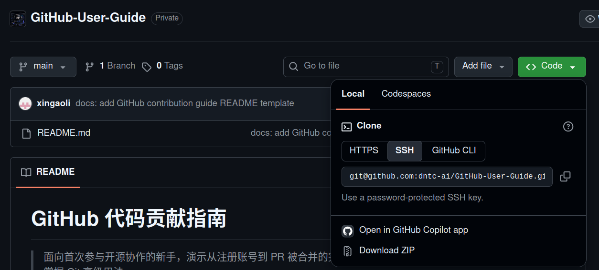
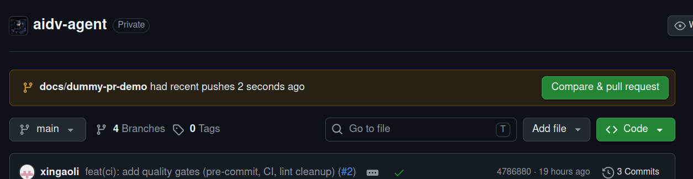
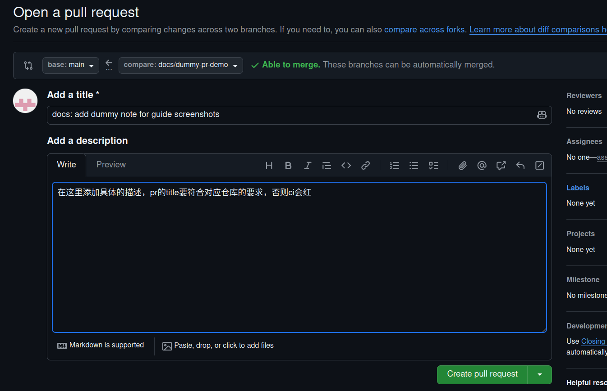
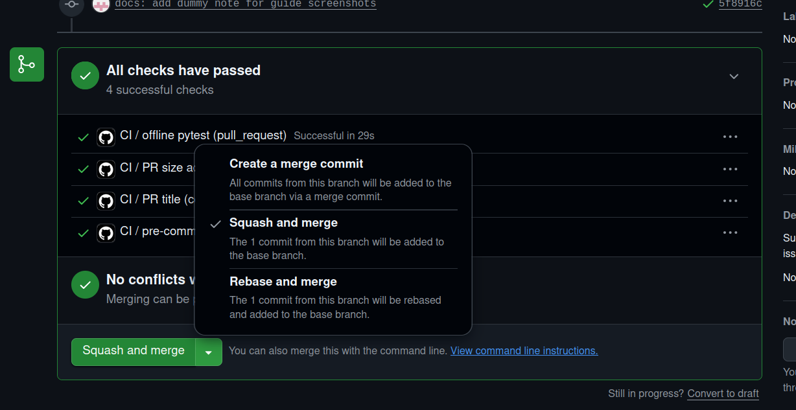

# GitHub 代码贡献指南

> 面向首次参与开源协作的新手，演示从注册账号到 PR 被合并的完整流程。
> 全程只需浏览器 + 一个终端，无需提前掌握 Git 高级用法。

> **TODO**：替换本仓库的组织名、示例仓库地址与联系方式，删除所有 `TODO` 标记后再发布。

## 目录

- [GitHub 代码贡献指南](#github-代码贡献指南)
  - [目录](#目录)
  - [0. 准备工作](#0-准备工作)
  - [1. 注册账号与配置 SSH Key](#1-注册账号与配置-ssh-key)
  - [2. 认识仓库页面](#2-认识仓库页面)
  - [3. 认领 Issue：贡献的第一步](#3-认领-issue贡献的第一步)
  - [4. Clone 仓库](#4-clone-仓库)
  - [5. 创建主题分支](#5-创建主题分支)
  - [6. 修改代码与提交](#6-修改代码与提交)
  - [7. Push 与发起 Pull Request](#7-push-与发起-pull-request)
  - [8. CI 检查与 Code Review](#8-ci-检查与-code-review)
  - [9. 合并与后续清理](#9-合并与后续清理)
  - [10. 常见问题](#10-常见问题)
  - [附录 A：示意图清单](#附录-a示意图清单)
  - [获取帮助](#获取帮助)

---

## 0. 准备工作

开始之前，请确认：

| 项目 | 要求 |
|---|---|
| 操作系统 | Windows / macOS / Linux 均可 |
| Git | ≥ 2.30，安装见 [git-scm.com](https://git-scm.com/downloads) |
| 终端 | 任意（Windows 推荐 PowerShell 或 Git Bash） |
| 编辑器 | 任意（VS Code / JetBrains 等） |

安装 Git 后先做一次全局配置（用户名与邮箱会出现在你的每个提交里）：

```bash
git config --global user.name  "你的名字"
git config --global user.email "you@example.com"
```

## 1. 注册账号与配置 SSH Key

1. 打开 [github.com/signup](https://github.com/signup)，用邮箱注册账号；
2. 登录后进入 **Settings → SSH and GPG keys → New SSH key**；
3. 本地生成密钥并复制公钥：

   ```bash
   ssh-keygen -t ed25519 -C "you@example.com"
   cat ~/.ssh/id_ed25519.pub
   ```

4. 将公钥内容粘贴到 GitHub 页面保存，测试连通性：

   ```bash
   ssh -T git@github.com
   # 出现 "Hi <用户名>! You've successfully authenticated" 即成功
   ```


## 2. 认识仓库页面

以本组织任一仓库为例，页面上最常用的几个入口：

| 区域 | 用途 |
|---|---|
| **Code** | 浏览代码、复制 clone 地址、下载 zip |
| **Issues** | 报告 bug、提出需求、认领任务 |
| **Pull requests** | 查看进行中的代码评审 |
| **Actions** | 查看 CI 流水线结果 |


## 3. 认领 Issue：贡献的第一步

**先认领、再动手**，避免与他人重复劳动：

1. 在 **Issues** 列表里寻找带有 `good first issue` / `help wanted` 标签的条目；
2. 在该 Issue 下留言「我认领这个任务」（例：`I'd like to work on this.`）；
3. 等维护者回复确认后再开始编码。


> **TODO**：按你们团队的实际约定修改认领方式（例如要求 @ 指定维护者、使用项目看板等）。

## 4. Clone 仓库

本组织的仓库为私有仓库且未开放 Fork，直接从组织仓库克隆：

1. 打开组织仓库页面，点击绿色 **Code** 按钮，切换到 **SSH** 页签并复制地址；
2. 克隆到本地：

   ```bash
   git clone git@github.com:<组织名>/<仓库名>.git
   cd <仓库名>
   ```

3. 确认远端配置：

   ```bash
   git remote -v   # origin 应指向组织仓库
   ```

> 克隆私有仓库需要你已被添加为仓库协作者（Collaborator）或组织成员，
> 并提前配置好 SSH Key（见 §1）。没有权限时先联系仓库管理员添加。



## 5. 创建主题分支

**永远不要直接在 `main` 上开发。** 从最新的 `main` 切出主题分支：

```bash
git switch main
git pull origin main            # 同步远端最新代码
git switch -c feat/short-desc   # 或 fix/short-desc
```

分支命名约定：

| 前缀 | 用途 | 示例 |
|---|---|---|
| `feat/` | 新功能 | `feat/export-pdf` |
| `fix/` | 缺陷修复 | `fix/login-timeout` |
| `docs/` | 文档 | `docs/quickstart` |


## 6. 修改代码与提交

1. 完成**一个聚焦的改动**——不要在一个 PR 里夹带多个不相关修改；
2. 查看改动并暂存：

   ```bash
   git status             # 确认只改了该改的文件
   git diff               # 逐行检查
   git add <文件...>       # 或 git add -p 逐块挑选
   ```

3. 提交，遵循 [Conventional Commits](https://www.conventionalcommits.org/zh-hans/)：

   ```bash
   git commit -m "feat(module): support xx"
   ```

   > 具体的 commit type 见具体仓库要求。

   | type | 用途 |
   |---|---|
   | `feat` | 新功能 |
   | `fix` | 缺陷修复 |
   | `docs` | 文档变更 |
   | `refactor` | 重构（不改行为） |
   | `test` | 测试 |
   | `chore` | 构建 / 工具链 / 杂项 |

提交前请确认：

- [ ] 新增逻辑有对应测试，且本地测试通过
- [ ] 通过了项目的 lint / format 检查
- [ ] 提交信息格式正确、描述清晰
- [ ] 没有提交临时文件、密钥、日志（可配置 `.gitignore`）

## 7. Push 与发起 Pull Request

1. 推送分支到组织仓库：

   ```bash
   git push -u origin feat/short-desc
   ```

2. 打开 GitHub，页面会出现 **Compare & pull request** 按钮，点击进入 PR 创建页；
   也可从 **Pull requests → New pull request** 手动发起；
3. 确认方向正确：`base: main ← compare: feat/short-desc`；
4. 填写 PR 标题与描述（标题同样遵循 Conventional Commits），勾选关联的 Issue（如 `Closes #123`）；
5. 点击 **Create pull request**。





**PR 描述建议包含：**

- 改了什么、为什么改（关联 Issue）
- 如何验证（测试方式、截图）
- 对使用者的潜在影响（ breaking change 需显著标注）

## 8. CI 检查与 Code Review

PR 发起后进入评审环节，流程如下：

1. **CI 自动检查**：在 PR 页面下方 **Checks** 标签查看各 job 运行结果，
   **必须全绿**才允许合并；红灯时点开日志修复后重新 push 即可；
2. **Reviewer 评审**：维护者会逐行 review，可能留下评论或修改建议（suggestions）；
3. **回应修改**：

   ```bash
   # 在同一分支继续修改、提交并 push，PR 会自动更新
   git add -A
   git commit -m "fix: address review comments"
   git push
   ```

   对 reviewer 的每条评论请逐一回复（Resolved / 说明理由），不要忽略；
4. 评审通过（Approve）且 CI 全绿后，等待维护者合并。


> **注意**：review 后请不要关闭 PR 重新开一个新的，直接在原分支上追加提交即可。

## 9. 合并与后续清理

1. 维护者以 **Squash and merge** 方式合并（你的多个提交会被压缩为 `main` 上的一个提交，
   PR 标题默认成为该提交的信息）；
2. 合并后清理本地与远端的主题分支：

   ```bash
   git switch main
   git pull origin main                     # 拉取合并后的最新代码
   git branch -d feat/short-desc            # 删除本地分支
   git push origin --delete feat/short-desc # 删除远端主题分支
   ```

   也可直接在合并完成的 PR 页面点击 **Delete branch** 按钮。

3. 在原 Issue 确认任务闭环，开始下一个贡献 🎉



## 10. 常见问题

<details>
<summary><b>本地 main 落后远端了，怎么更新？</b></summary>

```bash
git switch main
git pull origin main
```

自己的主题分支需要带上 `main` 的最新改动时：

```bash
git switch feat/short-desc
git fetch origin
git rebase origin/main
```

</details>

<details>
<summary><b>push 被拒绝（non-fast-forward）怎么办？</b></summary>

说明远端分支有你本地没有的提交。先 `git pull --rebase origin <分支>`，
解决冲突后 `git push`。**不要**随手使用 `git push -f`，除非你完全清楚后果。

</details>

<details>
<summary><b>提交信息写错了，还能改吗？</b></summary>

未 push：`git commit --amend`；已 push 且分支只有你一人使用：
`git commit --amend` 后 `git push -f`；已被他人拉取则不建议改写历史。

</details>

<details>
<summary><b>PR 冲突了怎么解决？</b></summary>

```bash
git switch feat/short-desc
git fetch origin
git rebase origin/main
# 逐个解决冲突文件后：
git add -A
git rebase --continue
git push -f
```

</details>

<details>
<summary><b>误把密钥 / 大文件提交了怎么办？</b></summary>

立即：① 吊销并更换泄露的密钥；② 用 `git rm --cached` 移除并补充 `.gitignore`；
已 push 的历史需要 `git filter-repo` 重写并联系维护者。**预防优于补救。**

</details>

---

## 附录 A：示意图清单

请将以下截图放入 `assets/` 目录（文件名保持一致，README 即可直接引用）：

| 文件名 | 内容 | 建议标注重点 |
|---|---|---|
| `01-register.png` | GitHub 注册页 | 邮箱、密码、用户名填写 |
| `02-ssh-key.png` | SSH Key 设置页 | Settings 入口与粘贴位置 |
| `03-repo-overview.png` | 仓库首页导览 | Code / Issues / PR / Actions 按钮 |
| `04-claim-issue.png` | Issue 认领 | 标签筛选与留言框 |
| `05-clone.png` | Clone 地址复制 | Code 按钮、SSH 页签与地址 |
| `06-branch.png` | 分支创建 | 命令执行结果 |
| `07-push.png` | push 输出 | `-u origin` 与成功提示 |
| `08-create-pr.png` | PR 创建页 | base/compare 方向、标题、描述 |
| `09-ci-checks.png` | CI 检查列表 | Checks 标签与 job 状态 |
| `10-review.png` | Review 评论 | Files changed 与 suggestion |
| `11-merge.png` | Squash merge | 合并按钮与确认框 |

截图规范：整页截图后裁剪到关键区域；用红框 / 箭头标注操作点；宽度统一 1200px 左右。

---

## 获取帮助

- 使用问题：先查本文 [常见问题](#10-常见问题)，再在仓库提 Issue
- **TODO**：补充团队内部沟通渠道（群 / 邮件 / 值班人）
